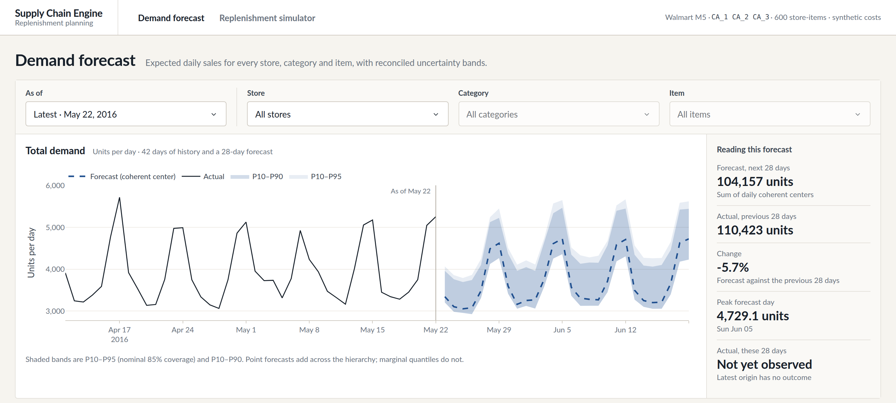
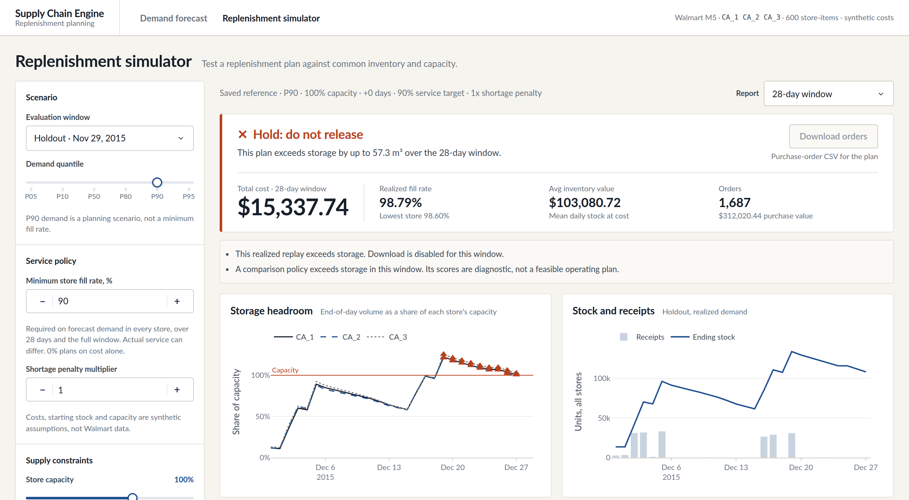

# Supply Chain Engine

[](https://github.com/chihab46/supply-chain-opt-engine/actions/workflows/ci.yml)

Forecast-to-replenishment planning for 600 store-item series from the Walmart M5
dataset (3 California stores). It forecasts daily demand with LightGBM quantile
models, reconciles them across a store/category/item hierarchy, and plans
purchase orders with a Pyomo/HiGHS optimizer that must meet a per-store fill
target within storage limits. Every result is replayed against actual sales and
checked against baselines, including a pre-registered test on unused data.



## Headline result

**The forecasts hold up out of sample. The inventory saving does not yet.**

| | Holdout, Dec 2015 | Fresh test, three 2016 windows |
| --- | --- | --- |
| Leaf WMAPE, LightGBM vs AutoETS | 59.2% vs 65.0% | 48.5–52.1% vs 51.8–55.9% |
| P05–P95 coverage (nominal 90%), LightGBM vs AutoETS | 89.6% vs 67.7% | 87.9–89.8% vs 64.8–66.9% |
| Weekly-replanned MILP vs weekly reorder rule | **30% cheaper**, both within storage and ≥90% fill | **No valid saving**: both exceed storage in every window |

On the fresh windows the optimizer still cost 28–33% less at 98%+ fill, but it
overflowed storage even inside the 28-day planning window, where the reorder
rule did not. It fills storage to the limit on a high (P90) forecast and has no
headroom when demand comes in lower. The windows, comparison and success rule
were [committed before the run](docs/fresh_evaluation.md); the verdict is
reported as it came out.



## How the result was reached

1. **The first optimizer ordered nothing.** A synthetic stockout penalty worth
   3–8 days of holding cost made lost sales cheap. It is now lost margin plus
   5–20% of price as goodwill, and high service became the cheapest plan.
2. **A plan fixed on day one overflowed storage** when demand came in below
   forecast. Weekly replanning on actual stock fixed that on the holdout.
3. **The first baseline was too weak.** Against a daily reorder rule the MILP
   looked 69% cheaper; against a weekly one, the fair comparison, 30%.
4. **A pre-registered fresh test did not confirm it**, and showed why: the
   optimizer leaves no storage buffer against forecast error.

Costs, lead times and capacities are synthetic (M5 has none), the MILP is not
proven optimal (31–55% gaps), and all M5 data is now used, so a storage fix
could only be tested exploratorily. See the [business brief](docs/business_case.md).

## How it works

| Stage | What it does | Details |
| --- | --- | --- |
| Ingestion | Validates M5, selects 600 series stratified by store, category and demand type, loads PostgreSQL | [Pipeline guide](docs/pipeline.md#scope-and-load) |
| Features | Leakage-safe SQL lags, rolling stats, prices and calendar, exported to Parquet | [features.md](docs/features.md) |
| Baselines | SeasonalNaive, AutoETS and TSB with conformal intervals on four seasonal folds | [baselines.md](docs/baselines.md) |
| Forecasts | Global LightGBM quantiles (P05–P95), Optuna-tuned on folds 1–3 only, SHAP drivers | [forecasting.md](docs/forecasting.md) |
| Reconciliation | 613-node hierarchy with Bottom-Up, Top-Down and MinT-shrink, coherent sample paths | [reconciliation.md](docs/reconciliation.md) |
| Optimization | Integer orders, MOQ, lead times, storage and a per-store fill floor; weekly rolling replans | [optimization.md](docs/optimization.md) |
| Evaluation | Replay on actual sales, eligibility rules, pre-registered fresh-period test | [fresh_evaluation.md](docs/fresh_evaluation.md) |
| Dashboard | Dash workbench: forecast drill-down and a scenario simulator with release decisions | [dashboard.md](docs/dashboard.md) |

## Quick start

Python 3.12 with [uv](https://docs.astral.sh/uv/), plus Docker for PostgreSQL.

```bash
cp -n .env.example .env
uv sync --extra dashboard --extra data
docker compose up -d postgres
```

Run the pipeline in order. The download needs a Kaggle account that has
accepted the M5 competition rules; raw data and outputs are not versioned.

```bash
uv run supply-chain-ingest download
uv run supply-chain-ingest load --selection-cutoff 2015-02-28
uv run python -m supply_chain_opt_engine.features
uv run python -m supply_chain_opt_engine.baseline
uv run python -m supply_chain_opt_engine.forecasting
uv run python -m supply_chain_opt_engine.reconciliation
uv run python -m supply_chain_opt_engine.optimization
uv run python -m supply_chain_opt_engine.fresh_evaluation
```

The fresh-period test reads the upstream run IDs pinned in `configs/default.yaml`
under `fresh_evaluation`; a new pipeline run produces new IDs, so update them
first.

Then open the dashboard at [localhost:8050](http://127.0.0.1:8050):

```bash
uv run --extra dashboard python -m app.dashboard
```

Checks: `uv run ruff check .` and `uv run pytest -m "not integration and not slow"`.
The [pipeline guide](docs/pipeline.md) covers every option, artifact and
measured result stage by stage.

## Repository

```text
app/                         Dash workbench (layout, charts, design tokens)
configs/default.yaml         Scope, folds, forecasting, solver and fresh-test settings
docs/                        Pipeline guide, model notes, business brief, evidence
sql/                         PostgreSQL schema and leakage-safe feature views
src/supply_chain_opt_engine/ Ingestion, features, models, reconciliation, optimizer
tests/                       Unit, SQL and PostgreSQL integration tests
```

Built with pandas, PostgreSQL, StatsForecast, MLForecast/LightGBM, Optuna,
SHAP, HierarchicalForecast, Pyomo/HiGHS and Dash. MIT licensed.
